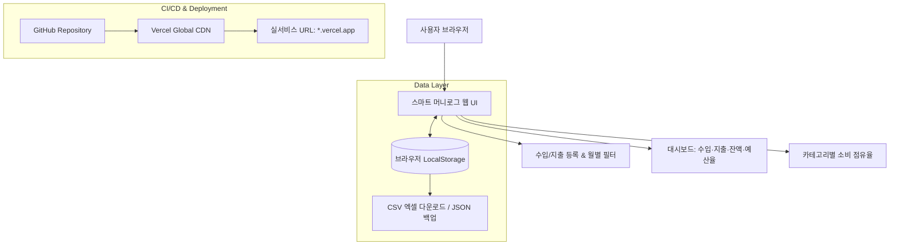

# 프로젝트 규칙 및 지침 (GEMINI.md)

## 프로젝트 개요
- **프로젝트명**: 스마트 머니로그 (Smart MoneyLog)
- **개발 목적**: 한국금융연수원 바이브코딩 실기평가 과제 — 자유 주제 웹 앱 개발 및 GitHub/Vercel 배포
- **기술 스택**: HTML5, CSS3, Vanilla JavaScript, Vercel
- **디자인 철학**: 사용자 중심의 핀테크 UX (직관적인 수치 강조, 카드형 UI, 모바일/데스크톱 반응형)

## 진행 상황 자동 업데이트 규칙
- 모든 내용은 한글로 작성합니다.
- 각 작업 단계를 완료할 때마다 체크리스트 항목을 `[x]`로 갱신합니다.
- 새로운 기술 결정이나 배포 URL이 확정되면 즉시 기록합니다.

## 개발 및 배포 체크리스트
- [x] Step 1: 기획 및 PRD.md 작성 (5W1H, 기능 요구사항, MVP 범위)
- [x] Step 2: 시맨틱 HTML5 구조 설계 (`index.html`)
- [x] Step 3: 모던 핀테크 CSS3 스타일링 (`style.css` - 카드 레이아웃, 모바일 반응형)
- [x] Step 4: 핵심 비즈니스 로직 및 LocalStorage 구현 (`app.js` - CRUD, 대시보드 통계)
- [x] Step 5: 부가 기능 구현 (월별 필터, 카테고리 분석 바, CSV/JSON 백업, 샘플 데이터)
- [x] Step 6: Vercel 배포 환경설정 (`vercel.json`, `.gitignore`, `README.md`)
- [x] Step 7: GitHub 저장소 업로드 및 Vercel 실시간 배포 검증

## 시스템 아키텍처 및 배포 흐름도

